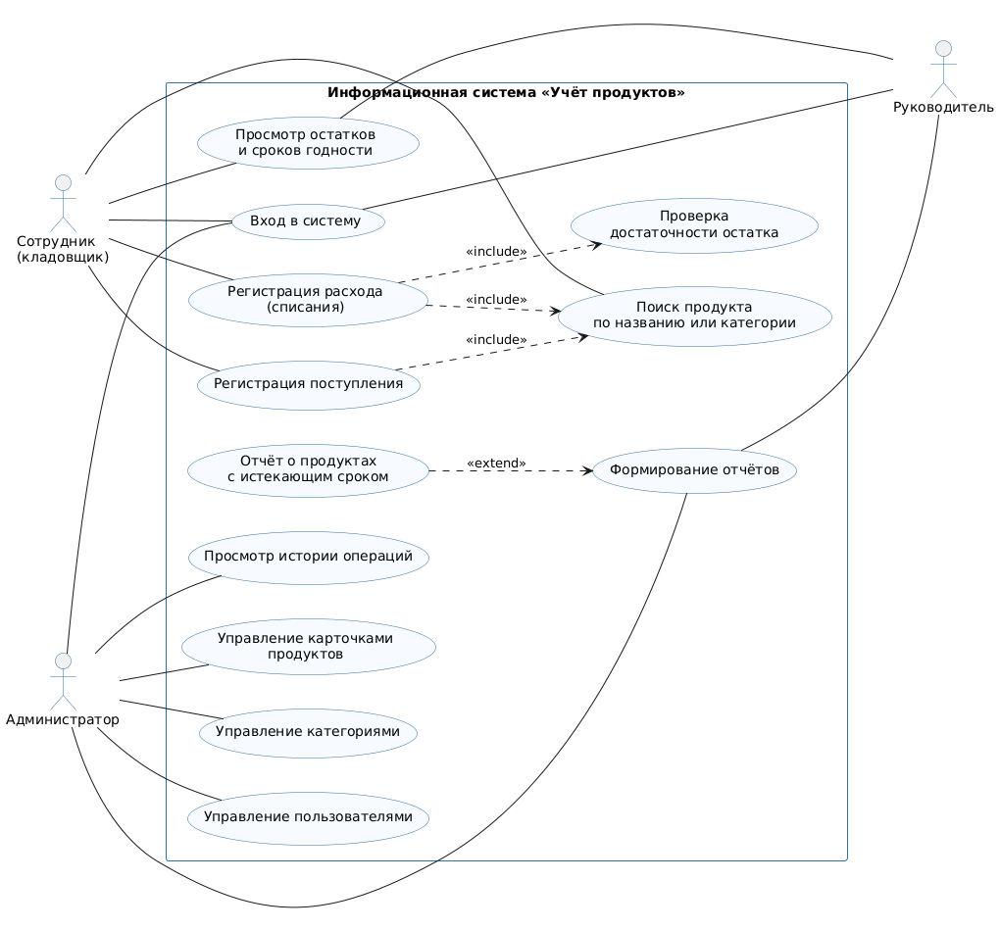
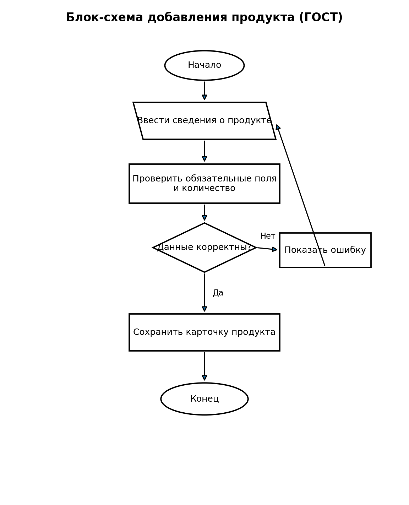
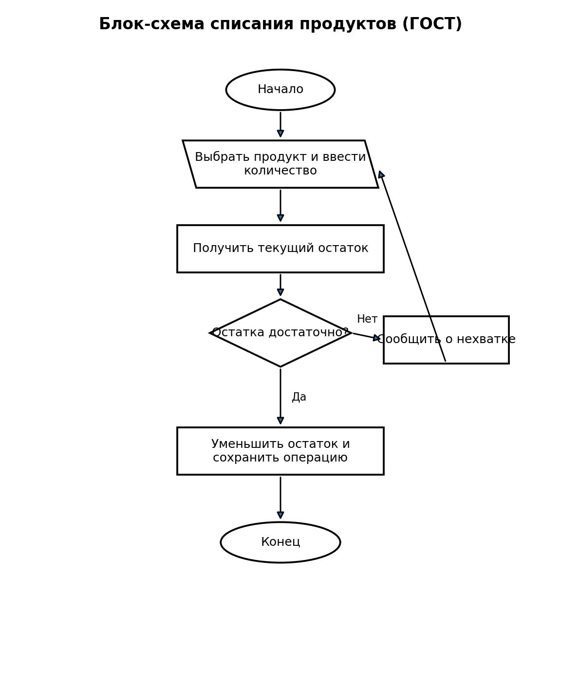
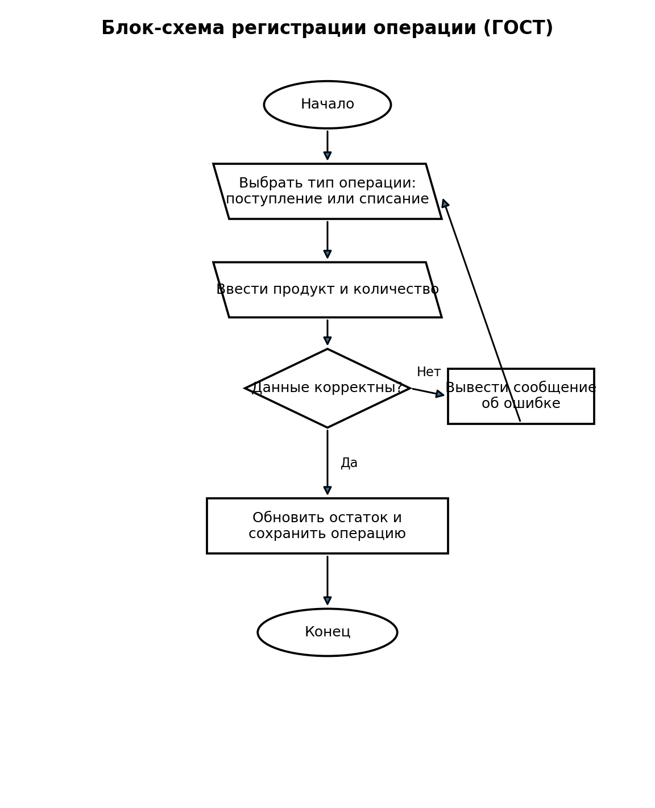

# ProductTrack — информационная система «Учёт продуктов»

**ProductTrack** — консольное приложение на Python для учёта продуктов в магазине, небольшом кафе или на складе.
Программа хранит карточки продуктов, регистрирует **поступление** и **расход**, показывает остатки
и предупреждает о продуктах, у которых *скоро заканчивается срок годности*.

> Учебный проект по дисциплине «Информатика», НГТУ им. Р. Е. Алексеева.
> Лабораторная работа №2 «Документирование программных проектов: GitHub, Markdown и PlantUML».
> Лабораторная работа №5 «Форматы данных: JSON, CSV, XML, YAML».

## Содержание

- [Описание предметной области](#описание-предметной-области)
- [Цели и задачи системы](#цели-и-задачи-системы)
- [Пользователи и роли](#пользователи-и-роли)
- [Функции системы](#функции-системы)
- [Диаграммы](#диаграммы)
- [Архитектура](#архитектура)
- [Структура проекта](#структура-проекта)
- [Установка и запуск](#установка-и-запуск)
- [Пример работы](#пример-работы)
- [Экспорт данных: JSON, CSV, XML, YAML](#экспорт-данных-json-csv-xml-yaml)
- [План развития](#план-развития)
- [Используемые технологии](#используемые-технологии)
- [Автор](#автор)

## Описание предметной области

В магазинах, кафе и на складах нужно следить за количеством продуктов: какие товары есть в наличии,
сколько единиц осталось, когда продукты поступили и у каких из них скоро истекает срок годности.
Если вести записи вручную, поиск информации занимает много времени, а при подсчётах появляются ошибки.

Система «Учёт продуктов» автоматизирует основные процессы:

- добавление новых продуктов и изменение их карточек;
- хранение названия, категории, количества, цены и срока годности;
- регистрация поступления продуктов на склад;
- учёт продажи, выдачи или списания продуктов;
- поиск товара по названию или категории;
- формирование отчёта об остатках и продуктах с истекающим сроком годности.

## Цели и задачи системы

1. Сократить время на поиск информации о продуктах.
2. Уменьшить ошибки при подсчёте остатков.
3. Контролировать поступление и расход товаров.
4. Своевременно замечать продукты с небольшим остаточным сроком годности.
5. Получать сведения о количестве и стоимости товаров.
6. Сохранять историю основных операций с продуктами.

## Пользователи и роли

| Роль | Что делает в системе | Права |
|------|----------------------|-------|
| **Администратор** | Ведёт карточки продуктов и категории, управляет пользователями, смотрит историю операций, формирует отчёты | Полный доступ |
| **Сотрудник (кладовщик)** | Регистрирует поступление и расход, ищет продукты, проверяет остатки и сроки годности | Работа с операциями |
| **Руководитель** | Просматривает остатки и отчёты для контроля работы | Только просмотр |

## Функции системы

**Функции администратора:**

- вход в систему по логину и паролю;
- добавление, редактирование и удаление карточек продуктов;
- создание и изменение категорий товаров;
- просмотр истории поступлений и списаний;
- формирование отчётов по остаткам и операциям.

**Функции сотрудника:**

- поиск продукта по названию или категории;
- регистрация поступления товара;
- указание количества проданных или списанных продуктов;
- проверка доступного остатка;
- просмотр срока годности и текущего количества.

### Входные и выходные данные

| Входные данные | Выходные данные |
|----------------|-----------------|
| Название продукта | Карточка продукта |
| Категория | Актуальный остаток |
| Количество и единица измерения | История операций |
| Цена за единицу | Отчёт по товарам |
| Дата поступления и срок годности | Список продуктов с истекающим сроком |

## Диаграммы

### Диаграмма вариантов использования (Use Case)

Диаграмма построена в [PlantUML](https://plantuml.com/ru/use-case-diagram).
Исходный текст: [`docs/diagrams/use_case.puml`](docs/diagrams/use_case.puml).



По сравнению с диаграммой из лабораторной работы №1 исправлено:

- связи актёров с прецедентами показаны **ассоциациями** (линиями без стрелок), как требует нотация UML;
- добавлены прецеденты «Вход в систему» и «Управление пользователями»;
- общие шаги вынесены в отношения `<<include>>` (поиск продукта, проверка остатка) и `<<extend>>` (отчёт по срокам годности).

### Блок-схемы алгоритмов

| Добавление продукта | Списание продуктов | Регистрация операции |
|:---:|:---:|:---:|
|  |  |  |

## Архитектура

Приложение разделено на слои: интерфейс отделён от бизнес-логики и данных.

```text
Пользователь
    │
    ▼
Консольное меню        (main.py, menu.py)
    │
    ▼
Бизнес-логика          (inventory.py)
    │
    ▼
Модели данных          (models.py)
    │
    ▼
Хранение данных        (сейчас — в памяти, далее — SQLite)
```

### Планируемая база данных

| Таблица | Назначение | Основные поля |
|---------|------------|---------------|
| `Products` | Продукты | название, категория, единица измерения, количество, цена, срок годности |
| `Operations` | Операции | дата, тип операции, продукт, количество |
| `Categories` | Категории | название категории |
| `Users` | Пользователи | логин, пароль, роль |

## Структура проекта

```text
ProductTrack/
│
├── docs/                          # Документация проекта
│   ├── diagrams/
│   │   ├── use_case.puml          # Use Case-диаграмма (исходный текст PlantUML)
│   │   └── use_case.png           # Сгенерированное изображение диаграммы
│   └── images/                    # Блок-схемы из лабораторной работы №1
│       ├── add_product.png
│       ├── write_off.png
│       └── register_operation.png
│
├── src/                           # Исходный код
│   └── producttrack/              # Основной пакет приложения
│       ├── __init__.py
│       ├── main.py                # Точка входа в программу
│       ├── menu.py                # Консольное меню
│       ├── inventory.py           # Бизнес-логика: продукты, операции, отчёты
│       ├── models.py              # Модели: Product, Operation
│       ├── database.py            # SQLite: таблицы categories и products
│       └── export_data.py         # Экспорт данных в JSON, CSV, XML, YAML
│
├── out/                           # Результат экспорта (создаётся автоматически)
│   ├── data.json
│   ├── data.csv
│   ├── data.xml
│   └── data.yaml
│
├── tests/                         # Автоматизированные тесты
│   ├── __init__.py
│   ├── test_inventory.py
│   └── test_export.py
│
├── .gitignore                     # Исключения для Git
├── README.md                      # Описание проекта
└── requirements.txt               # Зависимости проекта
```

## Установка и запуск

### Требования

- [Python](https://www.python.org/downloads/) **3.10** или выше;
- [Git](https://git-scm.com/downloads).

Внешние библиотеки не нужны — используется только стандартная библиотека Python.

### 1. Клонирование репозитория

```bash
git clone https://github.com/behruzfayziev11-lgtm/lab2.git
cd lab2
```

### 2. Виртуальное окружение (по желанию)

```bash
python -m venv .venv
```

Активация в Windows: `.venv\Scripts\activate`, в Linux и macOS: `source .venv/bin/activate`.

### 3. Запуск программы

Из корневой папки проекта:

```bash
python -m src.producttrack.main
```

### 4. Запуск тестов

```bash
python -m unittest -v
```

## Пример работы

При запуске программа загружает тестовые продукты и показывает главное меню:

```text
Hello, World! Добро пожаловать в систему «Учёт продуктов».

===== Учёт продуктов =====
1. Список продуктов
2. Добавить продукт
3. Поступление
4. Расход (списание)
5. Поиск
6. Отчёты
0. Выход
Выберите пункт: 1

 № | Название          | Категория             | Остаток |   Цена | Годен до
------------------------------------------------------------------------------
 1 | Молоко 3,2%       | Молочные продукты     |    24 л |  89.90 | 15.12.2026
 2 | Хлеб пшеничный    | Хлебобулочные изделия |   15 шт |  45.00 | 05.12.2026
 3 | Гречка            | Крупы                 |   40 кг | 110.00 | 25.08.2027
```

Если списать больше, чем есть на складе, программа сообщит об ошибке и остаток не изменится:

```text
Номер продукта: 1
Количество: 100
Ошибка: Недостаточно остатка: на складе 24 л.
```

## Экспорт данных: JSON, CSV, XML, YAML

Лабораторная работа №5. Программа выбирает таблицу `products`, связанную с таблицей `categories`,
извлекает все записи одним SQL-запросом и сохраняет их в четыре файла в папке `out/`
(папка создаётся автоматически, если её нет).

### Запуск

Из корневой папки проекта:

```bash
python -m src.producttrack.export_data
```

База данных `producttrack.db` создаётся при первом запуске и заполняется тестовыми продуктами.

### SQL-запрос

```sql
SELECT p.id, p.name, p.unit, p.quantity, p.price, p.expiry_date,
       c.id AS category__id, c.name AS category__name
FROM products AS p
LEFT JOIN categories AS c ON c.id = p.category_id
ORDER BY p.id;
```

Поля связанной таблицы названы по правилу `группа__поле`. Из них программа собирает вложенный
объект `category`. Чтобы выгрузить другую таблицу, достаточно изменить SQL-запрос,
`ROOT_TAG` и `ITEM_TAG` в `export_data.py`: логику менять не нужно.

### Результат

| Файл | Формат | Как представлена связанная таблица |
|------|--------|------------------------------------|
| `out/data.json` | JSON | вложенный объект `category` |
| `out/data.csv` | CSV | плоские колонки `category_id`, `category_name` |
| `out/data.xml` | XML | вложенный тег `<category>` |
| `out/data.yaml` | YAML | вложенный объект `category` (отступами) |

Пример записи в JSON:

```json
{
  "id": 1,
  "name": "Молоко 3,2%",
  "unit": "л",
  "quantity": 24.0,
  "price": 89.9,
  "expiry_date": "2026-12-15",
  "category": {
    "id": 1,
    "name": "Молочные продукты"
  }
}
```

Та же запись в YAML:

```yaml
- id: 1
  name: Молоко 3,2%
  unit: л
  quantity: 24.0
  price: 89.9
  expiry_date: "2026-12-15"
  category:
    id: 1
    name: Молочные продукты
```

### Сравнение форматов

| Формат | Вложенность | Читаемость | Где применяется |
|--------|:-----------:|:----------:|-----------------|
| JSON | да | высокая | API, обмен данными между приложениями |
| CSV | нет | средняя | импорт и экспорт таблиц, Excel |
| XML | да | средняя | конфигурации, веб-сервисы, сложные иерархии |
| YAML | да | высокая | конфигурации, DevOps, сериализация объектов |

## План развития

- [x] Постановка задачи, Use Case-диаграмма и блок-схемы (ЛР №1)
- [x] Репозиторий на GitHub, README и диаграмма PlantUML (ЛР №2)
- [ ] База данных SQLite из трёх и более связанных таблиц (ЛР №3)
- [ ] Слой доступа к данным и CRUD-операции (ЛР №4)
- [x] Выгрузка данных в JSON, CSV, XML и YAML (ЛР №5)

## Используемые технологии

- Python 3 — язык программирования;
- Git и GitHub — контроль версий;
- Markdown — оформление документации;
- PlantUML — построение диаграмм;
- SQLite — база данных;
- JSON, CSV, XML, YAML — форматы выгрузки данных.

## Автор

Студент группы 26-ИВТ-2-1 **Файзиев Б. С.**

Проект является учебным.
